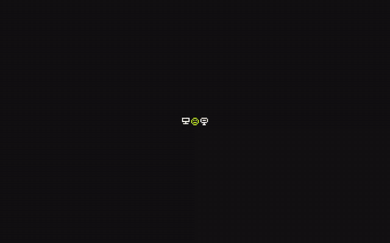

# RAKA'8 — situs portofolio pixel-art



HTML/CSS/JS native, tanpa build tool dan tanpa hosting. Buka `index.html` langsung di browser (double-click).

## Struktur

Folder ini adalah root situs (tidak ada subfolder `site/`).

```
index.html          Home: scroll-storytelling + loader + modal kontak
projects.html       Daftar proyek, hover video, pixel reveal, gallery modal, mode claw machine
game.html           Mini game "Pixel Dash" + leaderboard + modal simpan skor
assets/css/         base.css (token, font, tombol, modal) · home.css · shell.css (frame projects/game) · game.css
assets/js/          art.js (semua pixel art, digambar sebagai grid) · core.js (scramble text, grid trail kursor,
                    sound, modal kontak, scrollbar pixel) · home.js · projects.js · game.js · data.js (data proyek)
assets/fonts/       Mozilla Headline + Pixelify Sans (lokal, lisensi OFL)
assets/img/         favicon.svg · projects/ (24 foto Unsplash)
assets/video/       8 video Mixkit (p1–p8.mp4)
assets/audio/       10 SFX + 1 musik Mixkit
```

## Mengubah konten

- **Teks home**: langsung di `index.html` (tiap section diberi komentar). Teks "mode" di section About ada di `renderMode()` dalam `assets/js/home.js`; kata yang diketik di section Brain di `brain.words`; isi jendela pop-up di `WINS`.
- **Proyek**: `assets/js/data.js` (judul, tahun, klien, perusahaan, role, gambar, video).
- **Email**: `EMAIL` di `assets/js/core.js` + link `mailto:` di `index.html` dan `game.html`.
- **Pixel art** (avatar, otak, kartu, kacamata, tangan, kepala, ikon, logo): grid karakter di `assets/js/art.js` — satu karakter = satu pixel.

## Placeholder yang perlu diganti

- Nama brand **RAKA'8**, persona **Raka Pratama**, email **hello@raka8.dev**, link LinkedIn/Instagram (sekarang ke beranda situsnya).
- Semua nama klien/proyek (Lumora, Kopi Senja, Pixelwerk, dst.) dan nama di leaderboard game adalah fiktif.
- Form kontak tidak punya backend: setelah validasi, form membuka aplikasi email (mailto) dengan pesan terisi. Skor game disimpan di `localStorage` browser.

## State & interaksi yang dibuat

Loader ikon pixel (sekali per sesi) · scramble text per karakter · grid trail lime mengikuti kursor (blend difference) ·
bubble sapaan mengetik berganti bahasa · Developer/Creative mode (avatar, sprite, teks About ikut berubah, tersimpan per sesi) ·
navigasi section "chomper" yang memakan titik + klik untuk lompat · dock (sound/music toggle, telepon berdering → modal kontak, game, projects) ·
section pinned: pixel field, kepala berisi otak, otak terbelah + typing, helix DNA, kartu remi, kacamata (mata mengikuti kursor & berkedip),
dua tangan bertemu + percikan, jendela pop-up bertumpuk (bisa di-drag & ditutup, tombol No/Yes), tetris mengisi sampai "Perfect Fit!", globe pixel berputar ·
Projects: pixel reveal saat masuk viewport, hover → video, gallery fullscreen (panah, keyboard ←/→/Esc, drag/swipe), claw machine (←/→/Space atau tombol) ·
Game: Space lompat, S ganti mode, D/C power, tutorial on/off, sound on/off, game over → modal SAVE_SCORE → leaderboard.
`prefers-reduced-motion` dihormati.

## Verifikasi

Tidak ada tooling otomatis di folder ini. Cek manual: buka `index.html`, `projects.html`, `game.html` di browser dan pastikan console bebas error, semua gambar/video/audio termuat, dan layout tidak overflow di lebar desktop (1440) maupun mobile (390).
Skrip audit & perbandingan screenshot (Playwright) sebelumnya ada di `clone-kit/`, tetapi tidak lagi disertakan di folder ini.

## Kredit aset

Foto: Unsplash (lisensi Unsplash). Video, SFX, musik: Mixkit (lisensi gratis Mixkit). Font: Mozilla Headline & Pixelify Sans (SIL OFL).
